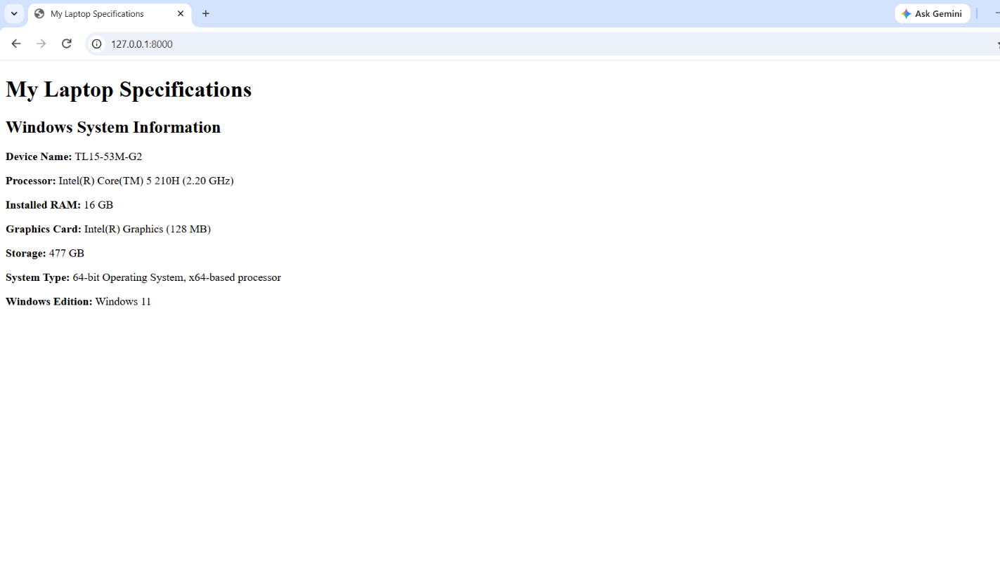

EX-1 Developing a Simple Webserver

Date:25.11.2026

AIM:

To develop a simple webserver to serve html pages and display the Windows Specifications of your Laptop.

DESIGN STEPS:

Step 1:
HTML content creation.

Step 2:
Design of webserver workflow.

Step 3:
Implementation using Python code.

Step 4:
Import the necessary modules.

Step 5:
Define a custom request handler.

Step 6:
Start an HTTP server on a specific port.

Step 7:
Run the Python script to serve web pages.

Step 8:
Serve the HTML pages.

Step 9:
Start the server script and check for errors.

Step 10:
Open a browser and navigate to http://127.0.0.1:8000 (or the assigned port).

PROGRAM:
```html
<!DOCTYPE html>
<html>
<head>
    <title>My Laptop Specifications</title>
</head>
<body>

    <h1>My Laptop Specifications</h1>

    <h2>Windows System Information</h2>

    <p><b>Device Name:</b> TL15-53M-G2</p>

    <p><b>Processor:</b> Intel(R) Core(TM) 5 210H (2.20 GHz)</p>

    <p><b>Installed RAM:</b> 16 GB</p>

    <p><b>Graphics Card:</b> Intel(R) Graphics (128 MB)</p>

    <p><b>Storage:</b> 477 GB</p>

    <p><b>System Type:</b> 64-bit Operating System, x64-based processor</p>

    <p><b>Windows Edition:</b> Windows 11</p>

</body>
</html>
```

OUTPUT:



RESULT:

The program for implementing simple webserver is executed successfully.
